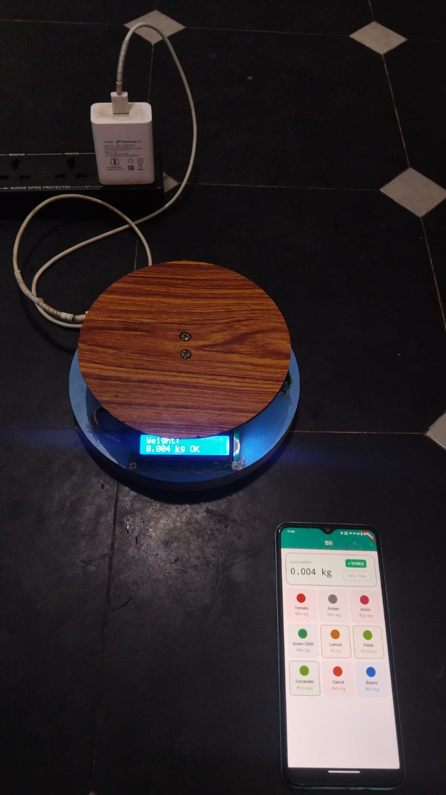
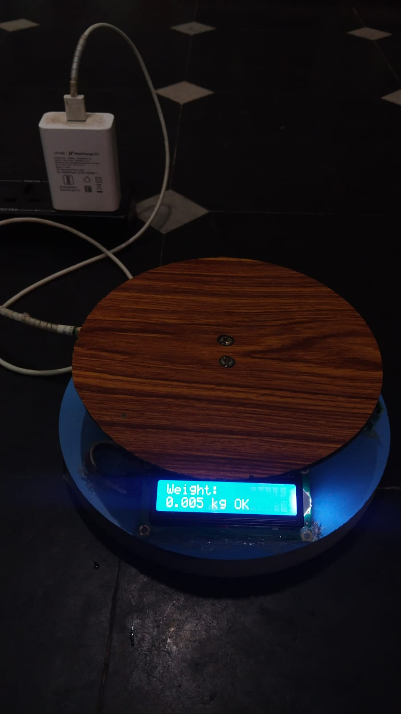

# SmartVeg — IoT Weighing & Billing System

A digital weighing scale and mobile billing app for street and market vegetable vendors.
Most small vendors weigh on a manual scale and calculate prices in their head, which is
slow, error-prone, and leaves no record of sales. SmartVeg connects a load cell to an
ESP32 and streams the live weight over Bluetooth Low Energy to a Flutter app, which
displays it in real time and only allows billing once the reading is stable.

**Tech:** ESP32 · Embedded C++ (Arduino) · Load cell + HX711 24-bit ADC · BLE GATT
(notify + write) · I2C LCD · Flutter / Dart

## Demo



The scale's LCD and the phone app show the same reading (0.004 kg) at the same moment:
the ESP32 streams every reading over BLE, and the app marks it STABLE when the scale
reports the weight has settled.



[Watch the demo video](https://youtube.com/shorts/CMie3A_l4C8?si=nM-9di3jpdAyebYQ)

## System architecture

```
Load cell ──(analog, ~mV)──► HX711 ──(2-wire serial: DT, SCK)──► ESP32
                             amplifier + 24-bit ADC

ESP32 ──(I2C, address 0x27)──────────► 16x2 LCD    live weight + OK / settling
ESP32 ──(BLE notify, ~2 readings/s)──► Phone app   "grams,stable"  e.g. "1486.0,1"
ESP32 ◄──(BLE write)────────────────── Phone app   "t" = tare
ESP32 ◄──(USB serial, 115200 baud)───► Laptop      readings out, "t" in (debugging)
```

- **Load cell → HX711:** the load cell is a Wheatstone bridge of strain gauges; weight
  produces a signal of only a few millivolts. The ESP32's 12-bit ADC is too coarse and
  noisy for that, so the HX711 amplifies it (gain 128) and digitises it with a 24-bit ADC.
- **HX711 → ESP32:** the HX711's own two-wire serial interface (data + clock).
- **ESP32 → LCD:** I2C, so the scale shows the weight on its own, with or without a phone.
- **ESP32 ↔ phone:** two-way BLE on one GATT characteristic: the ESP32 notifies every
  reading; the phone writes `t` to tare the scale, so the LCD and the app always agree.

## Hardware and wiring

| Component | Part |
|---|---|
| Microcontroller | ESP32 DevKit (ESP32-D0WD-V3) |
| Weight sensor | 5 kg load cell (strain-gauge bar) |
| ADC / amplifier | HX711 module (24-bit) |
| Display | 16x2 character LCD with I2C backpack |
| Power | 5 V USB |

| Signal | ESP32 pin |
|---|---|
| HX711 DT (data) | GPIO 26 |
| HX711 SCK (clock) | GPIO 25 |
| LCD SDA | GPIO 21 |
| LCD SCL | GPIO 22 |
| LCD I2C address | `0x27` (confirmed by an I2C bus scan at boot) |

## BLE protocol

The ESP32 is a BLE **peripheral** advertising as **`ESP32-Scale`**; the phone is the
**central**.

| Item | Value |
|---|---|
| Service UUID | `12345678-1234-1234-1234-1234567890ab` |
| Characteristic UUID | `abcd1234-5678-90ab-cdef-1234567890ab` |
| Properties | READ, NOTIFY, WRITE |

**Scale → phone (notify):** plain ASCII text `"<grams>,<stable>"`, about twice a second.

| Example | Meaning |
|---|---|
| `1486.0,1` | 1486.0 g, stable |
| `503.0,0` | 503.0 g, still settling |

**Phone → scale (write):** the single byte `t` tares the scale.

Plain text was chosen over a packed binary format because it can be read directly in a
serial monitor or in nRF Connect while debugging; at two readings a second the extra
bytes do not matter.

## Firmware design

Source: [`firmware/esp32_scale/esp32_scale.ino`](firmware/esp32_scale/esp32_scale.ino)

- **Calibration:** `scale.set_scale(101.16)` converts raw HX711 counts to grams;
  accuracy is about ±3 g. The scale tares itself at boot from 20 readings.
- **Averaging:** each reading is the average of 5 HX711 samples (`get_units(5)`).
- **Zero dead-band:** readings within ±2 g of zero, and small negatives, are shown as 0
  so an empty pan does not flicker.
- **Stability detection:** the last 5 readings are kept in a ring buffer; the weight is
  **stable** when their spread (max − min) is under 5 g. The flag is sent with every
  reading and shown on the LCD (`OK` / `..`).
- **Tare from two sources:** `t` from the Serial Monitor or from the phone over BLE.
  The BLE write callback only sets a `volatile` flag; `loop()` performs the tare. Taring
  takes about 1.5 s (20 samples), and blocking the BLE task that long could drop the
  connection. The stability window is cleared after each tare.
- **Reconnection:** advertising restarts automatically when the phone disconnects.

## Mobile app

Flutter (Dart), using [`flutter_blue_plus`](https://pub.dev/packages/flutter_blue_plus)
for BLE.

- **Connects automatically:** scans for `ESP32-Scale` (5 s), connects, discovers the
  service, and subscribes to notifications. A dot in the header turns green when
  connected.
- **Live weight panel:** weight in kg to 3 decimals, a STABLE / SETTLING badge, and a
  **Zero / Tare** button that writes `t` to the scale.
- **Vegetable grid:** 3-column tile grid with category filters (Top, Regular,
  Piece / Bunch, Slow, All).
- **Stability gate:** while the weight is settling, tiles are faded and cannot be
  tapped, and a banner says to wait — a bill can only use a settled weight.
- **Exact money:** prices are stored as whole paise in integers, never floating point.

| File | Purpose |
|---|---|
| `lib/weigh_screen.dart` | Weigh screen: BLE connection, live weight, tile grid, stability gate |
| `lib/weight_bar.dart` | Weight panel widget (reading, badge, tare button) |
| `lib/product.dart` | Product model and the product list |
| `lib/splash_screen.dart` | Opening screen |

## Project status

**Working now**
- Calibrated ESP32 scale with LCD, stability detection and tare
- Two-way BLE: live weight to the phone, tare command from the phone
- App: live weight, stable/settling status, tare button, filtered vegetable grid,
  stability-gated selection

**In progress**
- Tapping a tile adds the item to the bill (price = weight × rate) and auto-tares
- Cart, discounts, and paid bills
- Local SQLite database for products, bills and stock
- PDF bill sharing
- Several open bills at once for busy stalls

**Known limitations**
- While stable, the displayed weight can still move by a few grams (the window allows
  up to 5 g of spread).
- The app connects to the first device named `ESP32-Scale` and does not yet reconnect
  automatically if the link drops.
- If the phone's Bluetooth is off, the app does not yet show a message on screen.
- The scale runs on USB power; battery operation is not implemented.

## Running it

**Firmware:** open `firmware/esp32_scale/esp32_scale.ino` in the Arduino IDE with the
ESP32 board package and the `HX711` and `LiquidCrystal_I2C` libraries installed; select
*ESP32 Dev Module* and upload. Keep the pan empty during boot so the tare is correct.

**App:** with Flutter installed and an Android phone connected:
```
flutter pub get
flutter run
```
Turn on the phone's Bluetooth and allow the *Nearby devices* permission.

## Author

**Rajesh Pyla** — B.Tech ECE, final-year project.
GitHub: [CodeByRajeshPyla](https://github.com/CodeByRajeshPyla)
